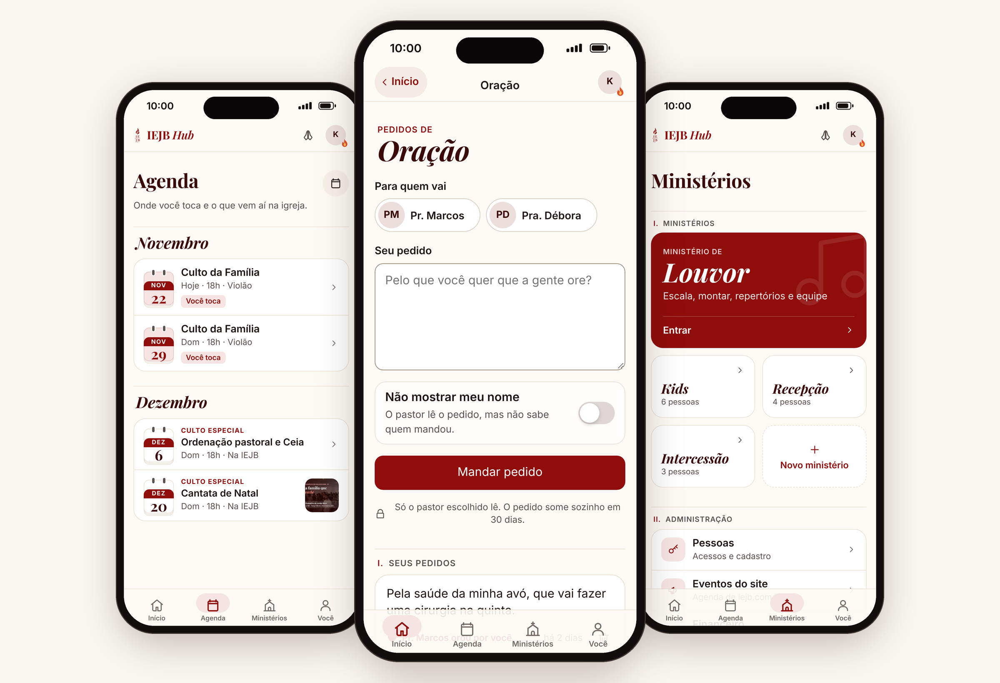
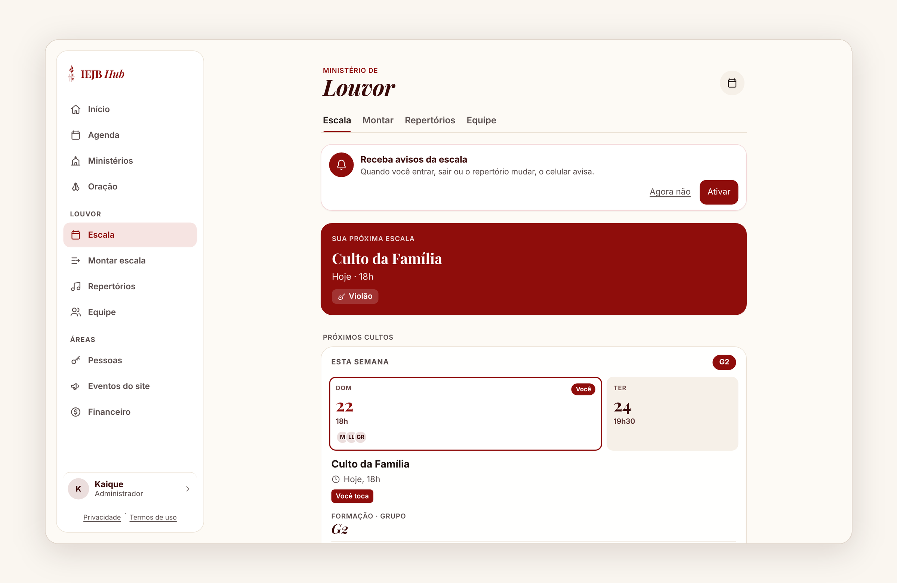

# IEJB Hub

Aplicativo interno da **IEJB - Igreja Evangélica do Jardim Brasil** (Araçariguama - SP). Junta num lugar só o que antes ficava espalhado em planilha, PDF e grupo de WhatsApp: os avisos da igreja, a escala do Louvor, os repertórios, os pedidos de oração, os ministérios, os eventos do site e o caixa.

Está no ar em [`app.iejb.com.br`](https://app.iejb.com.br) (acesso só para integrantes aprovados) e é usado pela igreja.




<sub>Capturas com dados de teste.</sub>

---

## O que ele faz

| Área | O que tem |
|---|---|
| **Início** | O próximo compromisso da pessoa (com contagem regressiva e o repertório no dia em que ela toca), aviso de aniversário de amanhã, contagem do caixa esperando a conferência dela, pedidos de acesso (admin) e o mural. |
| **Mural** | Avisos, fotos do culto e palavra, publicados pelo pastor e pela Comunicação, com fixar, guardar, editar e compartilhar no WhatsApp. Reações (Amém e coração) mostram quem reagiu. Cada membro compartilha **uma vez por semana** uma foto ou uma palavra (versículo ou mensagem curta); esses posts somem sozinhos em 90 dias. |
| **Oração** | O membro escolhe para qual pastor ou pastora manda o pedido, pode esconder o nome e recebe "Orei por você" quando o pastor marcar. O pastor recebe o pedido como notificação. O pedido some em 30 dias. |
| **Agenda** | As escalas da pessoa e os eventos da igreja, mês a mês. |
| **Ministérios** | Louvor e os outros ministérios (Kids, Recepção, Intercessão...) com a lista de quem serve e lidera. O admin cria ministérios novos. |
| **Pessoas** | O cadastro da igreja toda: título (pastor, presbítero, diácono, membro...), ministérios de cada um, permissões (Tesouraria, Comunicação, Vê o caixa) e convite pelo Gmail ou por um QR code grandão; quem entra pelo convite cai direto num pedido de acesso para o admin aprovar. |
| **Louvor: Escala** | As semanas em blocos (domingo, terça, sábado de jovens). Tocar no dia abre quem toca, os instrumentos e o repertório. "Não vou poder ir" avisa os líderes na hora. Funciona sem internet com a última escala vista. |
| **Louvor: Montar** | O líder monta o mês como fazia na planilha: um toque escolhe o grupo da semana, a escala se preenche sozinha e é publicada com aviso a quem foi afetado. Gera o resumo do mês em texto para o WhatsApp. |
| **Louvor: Repertórios** | Músicas por culto, com tom e ordem, botões para ouvir no Spotify, Apple Music e YouTube e a fila do culto no YouTube. Histórico pesquisável ("tocada 3 vezes, última em..."). |
| **Louvor: Equipe** | Os grupos que revezam (G1, G2...), quem toca o quê e quem lidera. |
| **Eventos do site** | A comunicação cadastra os eventos no Hub; o site [iejb.com.br](https://iejb.com.br) se atualiza sozinho a cada 15 min e o evento some depois que passa. |
| **Financeiro** | Só para a Tesouraria e quem recebeu "Vê o caixa". Entradas, saídas e transferências entre Caixa e PagBank, saldo por conta, resumo do mês e planilha para baixar. A contagem do culto passa por **dupla conferência**: quem contou escolhe quem confere, e só o valor conferido entra no caixa. Nada se apaga: erro é cancelado com motivo e fica no histórico. Dízimo só por total, **sem o nome de quem deu**. |
| **Avisos** | Notificação push quando a escala ou o repertório muda, quando sai post no mural, chega pedido de oração, é aniversário de alguém amanhã e, 3 dias antes do culto, um lembrete para quem vai tocar ensaiar. Mensagem pronta para o WhatsApp como reserva. |
| **Primeiro acesso** | Tela de boas-vindas e um tour curto que aponta onde fica cada coisa, sem forçar. |

Instala como app (PWA) no celular e funciona no navegador do computador, com barra lateral e layout próprio para tela larga.

<p align="center"></p>

## Como é feito

| Camada | Escolha |
|---|---|
| Front-end | Vite + JavaScript puro em módulos, sem framework. A única dependência do app é o `@supabase/supabase-js`. |
| Banco e login | Supabase (PostgreSQL 17, Auth, Storage, Edge Functions), servidor em São Paulo |
| Segurança | Toda permissão é regra do banco (RLS e funções `security definer`), não só da tela. Ser admin, por exemplo, **não** dá acesso ao caixa. |
| Hospedagem | Cloudflare Workers; cada push na `main` publica sozinho |
| Custo | Planos gratuitos de tudo |

```
app/                 o PWA (telas em src/telas, estilos em src/estilo, testes em testes)
supabase/migrations  o banco inteiro, em migrações numeradas
supabase/functions   admin-acesso, enviar-push, limpar-mural, links-da-musica, agenda, csp
supabase/tests/local testes do banco num Postgres local
docs/planejamento    visão, regras de negócio, modelo de dados, decisões
```

## Fluxo de desenvolvimento

Cada mudança segue o mesmo caminho:

1. **Levantamento.** Antes do código, as regras vêm de como a igreja funciona hoje (quem monta a escala, como os grupos revezam, quem pode ver o caixa) e viram as [regras de negócio](docs/planejamento/REGRAS-DE-NEGOCIO-PILOTO-LOUVOR.md) e o [modelo de dados](docs/planejamento/MODELO-DE-DADOS-E-PERMISSOES-PILOTO-LOUVOR.md).
2. **Decisão registrada.** Toda escolha que muda o produto vira uma linha numerada na [visão geral](docs/planejamento/VISAO-GERAL-IEJB-HUB.md), com o motivo; as técnicas ficam no [registro de decisões técnicas](docs/planejamento/REGISTRO-DE-DECISOES-TECNICAS.md). Decisão desfeita fica riscada, com o porquê.
3. **Banco primeiro.** Tabelas, regras de acesso e gatilhos entram como migração e rodam antes num Postgres local que simula logins diferentes (membro, líder, tesouraria, pastor, comunicação), conferindo o que cada um vê e o que é barrado: 433 verificações em `supabase/tests/local`.
4. **Tela.** Mudanças pequenas e incrementais sobre o que já existe.
5. **Conferência.** Cada tela é aberta num navegador automatizado com dados simulados, de 320 a 1440 px, procurando conteúdo vazando, alvo de toque pequeno e erro no console. Os fluxos principais (mural, oração, tour, convite, cadastro) têm 26 testes de ponta a ponta com Playwright, que também falham se aparecer `null`/`false` escrito na tela; acessibilidade pelo axe-core; teste final em iPhone e Android reais.
6. **Revisão antes de produção.** Migração no banco de produção só é aplicada depois de revisada.
7. **Publicação.** Commit em português (`feat:`, `fix:`, `style:`) na `main`; o Cloudflare publica em cerca de 2 minutos.

## Rodar localmente

```bash
cd app
# o .env precisa de VITE_SUPABASE_URL e VITE_SUPABASE_PUBLISHABLE_KEY (chave pública)
npm install
npm run dev
```

Testes de tela (Playwright, com o Supabase simulado; não precisa de internet):

```bash
cd app
npm test
```

Testes do banco (precisa de um PostgreSQL 16+ local):

```bash
cd supabase/tests/local
./rodar.sh
```

## Documentação

- [Visão geral e decisões](docs/planejamento/VISAO-GERAL-IEJB-HUB.md)
- [Regras de negócio do Louvor](docs/planejamento/REGRAS-DE-NEGOCIO-PILOTO-LOUVOR.md)
- [Modelo de dados e permissões](docs/planejamento/MODELO-DE-DADOS-E-PERMISSOES-PILOTO-LOUVOR.md)
- [Decisões técnicas](docs/planejamento/REGISTRO-DE-DECISOES-TECNICAS.md)
- [Banco de dados](supabase/README.md) · [Backup e restauração](supabase/BACKUP-E-RESTAURACAO.md)
- [Front-end](app/README.md)

## Privacidade

O que o Hub guarda, quem vê e como pedir para apagar está na própria tela de [privacidade](https://app.iejb.com.br/#/privacidade) (abre sem login).

---

## Licença

**© 2026 Kaique Diniz. Todos os direitos reservados.** O código está público só para consulta: não é código aberto, e usar, copiar, modificar ou instalar outra cópia exige autorização por escrito do autor. A IEJB tem permissão de uso na instalação mantida pelo autor, e os dados dela pertencem a ela. Detalhes em [LICENSE](LICENSE).

Desenvolvido por Kaique Diniz, com o [Claude Code](https://claude.com/claude-code) como ferramenta de desenvolvimento.
