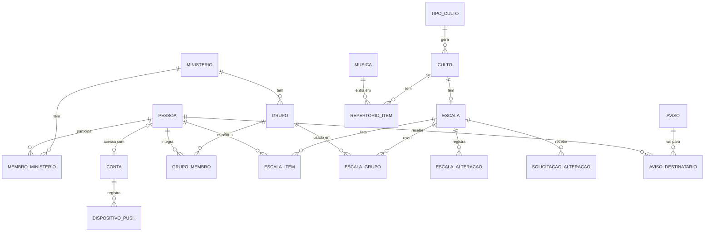

# IEJB Hub: Modelo de Dados e Permissões do Piloto Louvor

| Campo | Valor |
|---|---|
| **Escopo** | MVP do IEJB Hub, restrito ao ministério de Louvor |
| **Etapa** | 3. Planejamento do banco de dados e das permissões |
| **Versão** | 0.4 (implementado no Supabase) |
| **Última atualização** | 13/11/2026 |
| **Documento base** | [Regras de negócio do piloto Louvor](REGRAS-DE-NEGOCIO-PILOTO-LOUVOR.md), v0.5 |

> Este documento descreve **quais dados existem, como se relacionam e quem pode fazer o quê com eles**. Ele não contém SQL, telas nem código: isso é da etapa 4. Os nomes são conceituais e podem mudar na implementação.
>
> Banco e backend (PostgreSQL, Supabase, RLS) foram decididos em 13/11/2026 (D20), com os motivos no [registro de decisões técnicas](REGISTRO-DE-DECISOES-TECNICAS.md). O modelo continua escrito de forma conceitual, sem SQL.

---

## Como ler este documento

| Marcador | Significado |
|---|---|
| ✅ **Vem das regras** | Decorre direto de uma regra de negócio já registrada (citada como `RN-xx`). |
| 💡 **Proposta** | Escolha de modelagem minha para fechar uma lacuna. Precisa ser aceita ou ajustada por Kaique. |
| ❓ **Em aberto** | Depende de uma resposta. Listado na [seção 8](#8-questões-em-aberto). |

---

## 1. Princípios do modelo

1. ✅ **Pessoa e conta são coisas separadas** (RN-10, D14). A pessoa existe sem conta; a conta liga uma pessoa ao login.
2. ✅ **Ministério é uma entidade própria** (RN, seção 2), e tudo que é específico de ministério carrega o ministério. Assim, outros ministérios entram sem refazer a base (D14). Pessoas, cultos e contas são compartilhados.
3. ✅ **A escala é de pessoas, e o grupo é só atalho** (RN-31). O banco guarda as pessoas escaladas e, à parte, quais grupos foram usados (RN-56).
4. ✅ **Nada que já foi usado é apagado**: pessoas saem desativadas (RN-13), cultos são cancelados (RN-23), músicas usadas são desativadas, não excluídas.
5. ✅ **Permissão é verificada no banco** (RN-01, D4), não só na tela.
6. 💡 **Papéis são derivados dos dados, sem tabela genérica de permissões.** "Líder de grupo" é quem está como líder em um grupo; "líder de louvor" é um marcador no vínculo com o ministério; "administrador" é um marcador na conta. Com 4 papéis fixos, uma tabela configurável de cargos e permissões seria complexidade sem uso. **Risco:** quando entrarem outros ministérios e a estrutura de cargos (A6) for definida, essa parte pode precisar evoluir. O restante do modelo não depende dela.

---

## 2. Visão geral

| Bloco | Tabelas |
|---|---|
| Pessoas e acesso | `pessoa`, `conta`, `membro_ministerio`, `dispositivo_push` |
| Estrutura do Louvor | `ministerio`, `grupo`, `grupo_membro` |
| Cultos | `tipo_culto`, `culto` |
| Escala | `escala`, `escala_item`, `escala_grupo`, `escala_alteracao`, `solicitacao_alteracao` |
| Repertório | `musica`, `repertorio_item` |
| Avisos | `aviso`, `aviso_destinatario` |
| Rastro | `registro_auditoria` |

---

## 3. Tabelas e campos

Todas as tabelas têm identificador próprio, `criado_em` e `atualizado_em`, que não são repetidos abaixo.

### 3.1. Pessoas e acesso

**`pessoa`**: quem faz parte do Louvor, tenha ou não conta (RN-10, RN-14).

| Campo | Descrição |
|---|---|
| `nome` | Nome completo. |
| `apelido` | Como é chamada no Louvor. |
| `contato` | Meio de contato, **visível para todos os integrantes** (Q22). O login da conta não aparece para os outros. |
| `instrumentos` | 💡 O que a pessoa toca ou canta em geral (ex.: bateria, violão, canto). Serve de sugestão ao definir o padrão em cada grupo; não é uma trava. |
| `ativa` | `falso` quando sai do Louvor (RN-13). Nunca se apaga. |

**`conta`**: acesso de uma pessoa ao Hub (RN-10, RN-64, RN-65).

| Campo | Descrição |
|---|---|
| `login` | Identificador de login (e-mail, ver RN-64). A senha fica guardada pelo serviço de autenticação, nunca nesta tabela. |
| `pessoa_id` | Pessoa dona da conta. **Vazio enquanto a solicitação está pendente**; preenchido pelo administrador ao aprovar. Único: uma pessoa, no máximo uma conta. |
| `estado` | `pendente`, `ativa`, `recusada` ou `desativada`. |
| `e_administrador` | Marcador de administrador (RN-03). 💡 O sistema nunca deixa a conta do último administrador perder o marcador. |
| `senha_temporaria` | `verdadeiro` quando o administrador definiu a senha e a pessoa ainda precisa trocá-la (RN-10, RN-65). |
| `decidido_por`, `decidido_em` | Quem aprovou ou recusou a solicitação, e quando. |

**`membro_ministerio`**: vínculo da pessoa com um ministério (D14).

| Campo | Descrição |
|---|---|
| `pessoa_id`, `ministerio_id` | O vínculo. Único por par. |
| `e_lider` | Marca o líder de louvor (RN-02). 💡 O modelo permite mais de um, mas as regras falam em "o líder de louvor", então o piloto usa um só. |
| `ativo` | Acompanha a desativação da pessoa (RN-13). |

**`dispositivo_push`**: um aparelho que recebe notificações (RN-63, D18).

| Campo | Descrição |
|---|---|
| `conta_id` | Dona do aparelho. Uma conta pode ter vários. |
| `assinatura` | Dados da inscrição de push entregues pelo navegador (endereço e chaves). |
| `ativo` | Desligado quando o serviço de push informa que a inscrição deixou de valer. |

### 3.2. Estrutura do Louvor

**`ministerio`**: no piloto, só o registro **Louvor**.

| Campo | Descrição |
|---|---|
| `nome` | Nome do ministério. |

**`grupo`**: G1, G2 e G3 (RN-12).

| Campo | Descrição |
|---|---|
| `ministerio_id`, `nome` | A que ministério pertence e como se chama. |
| `lider_pessoa_id` | Líder do grupo. Um único, e precisa ser membro desse grupo. |
| `ativo` | Grupos extintos ficam guardados. |

**`grupo_membro`**: pessoa dentro de um grupo (RN-11, RN-16, RN-17).

| Campo | Descrição |
|---|---|
| `grupo_id`, `pessoa_id` | O vínculo. Único por par; a pessoa pode estar em vários grupos. |
| `instrumentos` | Instrumentos ou funções dessa pessoa **nesse grupo**, definidos pelo líder do grupo (Q16, Q18). Pode ter mais de um. Funcionam como o **padrão** ao escalar o grupo (Q19). |

### 3.3. Cultos

**`tipo_culto`**: o culto que se repete (RN-20, RN-21).

| Campo | Descrição |
|---|---|
| `nome`, `dia_semana`, `horario` | Ex.: Culto de Oração, terça, 19h30. |
| `tem_louvor` | A EBD existe como tipo, mas sem louvor, e não entra nas escalas. |

**`culto`**: uma ocorrência com data e hora (RN-20 a RN-23).

| Campo | Descrição |
|---|---|
| `tipo_culto_id` | Vazio nos **cultos especiais** (RN-22). |
| `nome`, `data`, `horario` | Cultos recorrentes herdam do tipo; especiais têm os próprios. |
| `tem_louvor` | Só cultos com louvor entram na escala. |
| `estado` | `ativo` ou `cancelado` (RN-23). |

💡 Os cultos recorrentes são gerados a partir dos tipos. Por quanto tempo à frente e se é automático ou por botão fica para a etapa 4.

### 3.4. Escala

**`escala`**: a escala de um culto para um ministério (RN-30, RN-34, RN-35).

| Campo | Descrição |
|---|---|
| `culto_id`, `ministerio_id` | Única por par. |
| `estado` | `rascunho` ou `publicada`. |
| `publicada_em` | Quando foi publicada pela primeira vez. |
| `alterada_por`, `alterada_em` | Quem fez a última alteração e quando (RN-35). |

**`escala_item`**: uma pessoa escalada (RN-31, RN-33, RN-15).

| Campo | Descrição |
|---|---|
| `escala_id`, `pessoa_id` | Única por par: ninguém aparece duas vezes (RN-33). |
| `instrumento_exibido` | Texto mostrado na escala. Começa como **cópia do padrão** da pessoa no grupo usado, e o líder de louvor muda por culto quando precisar, inclusive invertendo os papéis (RN-17, Q19). 💡 A cópia evita que mudar o padrão de alguém hoje reescreva escalas antigas. |
| `origem_grupo_id` | Grupo usado como atalho para incluir a pessoa. Vazio para avulsas. Só informativo. |

**`escala_grupo`**: grupos usados para montar a escala (RN-56).

| Campo | Descrição |
|---|---|
| `escala_id`, `grupo_id` | Existe para saber quais líderes de grupo podem editar o repertório e pedir alterações naquele culto (Q20, Q21). Gravado quando o líder de louvor escolhe o grupo como atalho. 💡 Ele pode remover um grupo da lista. |

**`escala_alteracao`**: registro de cada mudança feita em uma escala publicada.

| Campo | Descrição |
|---|---|
| `escala_id`, `tipo` | `publicada`, `entrou`, `saiu`, `instrumento_mudou`, `culto_cancelado`. |
| `pessoa_id` | Quem entrou, saiu ou mudou (vazio nos tipos que não são sobre uma pessoa). |
| `feita_por`, `feita_em` | Autor e momento. |

💡 **Por que existe:** o aviso para "quem entrou, saiu ou continua escalado" (RN-41, Q14) precisa saber *o que mudou*, e a escala sozinha só mostra o estado atual. Esse registro também sustenta o agrupamento de avisos (RN-45) e o histórico futuro. É só de acréscimo: nunca se edita.

**`solicitacao_alteracao`**: pedido do líder de grupo ao líder de louvor (RN-37 a RN-39).

| Campo | Descrição |
|---|---|
| `escala_id`, `autor_pessoa_id` | Escala sobre a qual é o pedido e quem pediu. O autor precisa ser líder de um grupo que consta em `escala_grupo` dessa escala (Q20). |
| `texto` | Texto livre (RN-39). |
| `estado` | `pendente`, `aprovada` ou `reprovada`. |
| `motivo` | Opcional, usado na reprovação. |
| `decidida_por`, `decidida_em` | Quem decidiu e quando. |

### 3.5. Repertório

**`musica`**: cadastrada uma vez (RN-52).

| Campo | Descrição |
|---|---|
| `titulo`, `artista` | Identificação. |
| `link` | Link opcional para cifra ou vídeo. |
| `ativa` | Música usada em algum repertório não é apagada, só desativada. |

**`repertorio_item`**: uma música no repertório de um culto (RN-50 a RN-53).

| Campo | Descrição |
|---|---|
| `culto_id`, `ministerio_id` | A que culto e ministério pertence. |
| `musica_id` | Qual música. |
| `posicao` | Ordem no repertório; ela importa (RN-53). Única por culto. |
| `tom` | O tom **neste culto** (RN-51). |

💡 O repertório é editado por **linha** (adicionar, tirar, reordenar), não regravando a lista inteira. Como vale "a última alteração salva" (RN-56), isso evita que dois líderes se sobrescrevam sem querer quando mexem em músicas diferentes.

### 3.6. Avisos

**`aviso`**: uma comunicação a ser entregue (RN-40 a RN-47).

| Campo | Descrição |
|---|---|
| `tipo` | `escala_alterada`, `repertorio_alterado`, `solicitacao_nova`, `solicitacao_decidida`, `culto_cancelado`. |
| `escala_id` ou `culto_id`, `solicitacao_id` | A que o aviso se refere. |
| `resumo` | Texto do que mudou. |

**`aviso_destinatario`**: quem recebe cada aviso. Serve também como a central de notificações dentro do app.

| Campo | Descrição |
|---|---|
| `aviso_id`, `pessoa_id` | Único por par. |
| `push_enviado_em`, `push_erro` | Resultado da tentativa de push. |
| `lido_em` | Quando a pessoa viu. |

A mensagem pronta para o WhatsApp (RN-43) **não é guardada**: é montada na hora a partir da escala.

### 3.7. Rastro

**`registro_auditoria`**: só para ações administrativas sensíveis (💡 proposta).

| Campo | Descrição |
|---|---|
| `ator_conta_id`, `acao`, `alvo` | Quem fez, o quê e sobre quem. Ex.: aprovou conta, redefiniu senha, designou administrador. |
| `feito_em` | Momento. |

Só de acréscimo, visível só para administradores. Como o administrador define senhas de outras pessoas, deixar esse rastro protege inclusive ele.

---

## 4. Regras de integridade

O banco deve **recusar** dados que violem estas regras, sem depender da tela.

| Regra | Origem |
|---|---|
| Uma pessoa tem no máximo uma conta. | Glossário |
| Pessoa e ministério formam um vínculo único. | D14 |
| Um grupo tem um único líder, e ele é membro do grupo. | RN-12 |
| A mesma pessoa não pode estar duas vezes na mesma escala. | RN-33 |
| Existe no máximo uma escala por culto e ministério. | RN-30 |
| Só cultos com louvor recebem escala. | RN-20 |
| As posições do repertório de um culto não se repetem. | RN-53 |
| Pessoa, culto, música e grupo referenciados em algo não podem ser excluídos, só desativados. | RN-13, RN-23 |
| Sempre sobra ao menos um administrador. | 💡 |
| Conta pendente não tem pessoa nem acesso. | RN-10 |

---

## 5. Permissões

### 5.1. Como o banco descobre quem é quem

A cada operação, o banco olha a conta logada e deriva o papel dos dados (princípio 6):

| Papel | Como é reconhecido |
|---|---|
| **Sem acesso** | Conta `pendente`, `recusada` ou `desativada`, ou sem pessoa vinculada. Não vê nada. |
| **Integrante** | Conta `ativa`, com pessoa ativa vinculada ao ministério. |
| **Líder de grupo** | Integrante que consta como `lider_pessoa_id` de um grupo ativo. |
| **Líder de louvor** | Integrante com `e_lider` no vínculo com o ministério. |
| **Administrador** | Conta `ativa` com `e_administrador`. |

Papéis se acumulam (RN, seção 3.1): quem é administrador e líder de louvor tem os dois conjuntos de permissões.

### 5.2. Quem pode o quê, tabela a tabela

Legenda: **ver** · **criar** · **editar** · **-** sem acesso. "Integrante" vale também para o líder de grupo quando a coluna dele estiver igual.

| Tabela | Administrador | Líder de louvor | Líder de grupo | Integrante |
|---|---|---|---|---|
| `conta` | ver todas; criar; aprovar ou recusar; redefinir senha; designar administrador | - | só a própria | só a própria (ver; trocar a própria senha) |
| `pessoa` | ver e editar todas | ver e editar todas | ver nome, apelido e contato de todas; editar o próprio contato | igual ao líder de grupo |
| `membro_ministerio` | ver e editar; designa o líder de louvor | ver e editar | ver | ver |
| `grupo` | criar e editar (inclui trocar o líder) | criar e editar (inclui trocar o líder) | ver | ver |
| `grupo_membro` | ver e editar | ver e editar | ver; editar **só do próprio grupo** (RN-16) | ver |
| `tipo_culto`, `culto` | criar e editar, cancelar | criar e editar, cancelar | ver | ver |
| `escala`, `escala_item`, `escala_grupo` | ver **só as publicadas** | ver e editar tudo, inclusive rascunho; publicar | ver só publicadas | ver só publicadas |
| `escala_alteracao` | ver | ver | - | - |
| `solicitacao_alteracao` | - | ver todas; decidir | criar só em cultos do próprio grupo; ver as próprias | - |
| `musica` | criar e editar | criar e editar | criar e editar | ver |
| `repertorio_item` | editar de qualquer culto | editar de qualquer culto | editar só quando o grupo está em `escala_grupo` de uma escala **publicada** do culto | ver |
| `aviso`, `aviso_destinatario` | ver os próprios | ver os próprios | ver os próprios | ver os próprios |
| `dispositivo_push` | só os próprios | só os próprios | só os próprios | só os próprios |
| `registro_auditoria` | ver | - | - | - |

Quem **escreve** em `escala_alteracao`, `aviso`, `aviso_destinatario` e `registro_auditoria` é o próprio sistema, nunca um usuário diretamente.

### 5.3. Casos que merecem atenção

1. **Administrador não edita escala** (RN-02). Por coerência com RN-34 ("rascunho: só quem pode editar"), 💡 ele também **não vê rascunhos**, a não ser que acumule o papel de líder de louvor. Se você preferir que ele veja, é um ajuste simples.
2. **Rascunho é invisível para integrantes e líderes de grupo** (RN-34). Isso precisa ser garantido no banco, senão basta abrir o app com a consulta certa para ver a escala antes da publicação.
3. **Repertório de um culto sem grupos** (só avulsos, ou sem escala): só líder de louvor e administrador editam (Q13).
4. **Repertório e rascunho:** como o líder de grupo não vê rascunhos, ele só edita o repertório depois que a escala é **publicada**, sem prazo: quando quiser (Q21).
5. **Solicitação aprovada não altera a escala sozinha** (RN-39). O líder de louvor edita manualmente, e o aviso sai da edição, não da aprovação.
6. **Senha temporária** (RN-10, RN-65): enquanto `senha_temporaria` estiver ativa, a pessoa só pode trocar a senha. 💡 Isso vale no banco, não só na tela. A senha temporária deve ser de uso único: depois da troca, nem o administrador a conhece.
7. **Conta pendente** (RN-10): pode existir, mas não lê nem grava nada. Como a tela "pedir acesso" é pública, essa trava é a única coisa entre um desconhecido e os dados do Louvor.

### 5.4. O que exige backend com poderes especiais

Algumas operações não podem rodar no navegador do usuário, porque dependem de uma credencial que ignora as regras acima. Devem ficar em funções de servidor, chamadas só depois de conferir que quem pede é administrador (ou o próprio sistema):

| Operação | Por quê |
|---|---|
| Criar conta com senha temporária e redefinir senha | Mexe no serviço de autenticação (RN-10, RN-65). |
| Aprovar solicitação de acesso e ligar a uma pessoa | Muda `estado` e `pessoa_id` da conta. |
| Calcular destinatários e enviar push | Lê dispositivos de outras pessoas (RN-42). |
| Designar administrador | Muda `e_administrador`. |
8. **`escala_grupo` manda em duas permissões:** repertório e solicitação de alteração. Se o líder de louvor tirar um grupo dessa lista, o líder daquele grupo perde as duas naquele culto.

---

## 6. Como os avisos são calculados

1. O líder de louvor publica ou altera uma escala publicada. O sistema grava as linhas em `escala_alteracao` (RN-40).
2. 💡 O envio espera uma **janela curta de silêncio** (por exemplo, 5 minutos) e junta tudo que mudou naquela escala em **um único aviso** (RN-45). O tamanho da janela fica para a etapa 4.
3. **Destinatários** (RN-41, Q14): quem entrou, quem saiu e quem continua escalado. Para uma publicação inicial, todos os escalados.
4. Mudança de repertório avisa as pessoas escaladas (RN-55), com a mesma janela.
5. Cada destinatário vira uma linha em `aviso_destinatario`, e o push vai para os aparelhos da conta (RN-63).
6. A mensagem de WhatsApp (RN-43) é montada na hora, quando o líder pede.
7. Nova solicitação avisa o líder de louvor (RN-46), e a decisão avisa o autor (RN-47). Esses dois avisos saem na hora, sem janela.

⚠️ Quem **saiu** da escala recebe o aviso mesmo não estando mais nela. Por isso o destinatário vem de `escala_alteracao`, não só de `escala_item`.

---

## 7. Preparação para os outros ministérios

Para a comunidade e outros ministérios entrarem depois (D14, A5) sem refazer a base:

- `ministerio_id` já existe em `grupo`, `escala` e `repertorio_item`, e o vínculo `membro_ministerio` já separa a pessoa do ministério.
- `pessoa`, `conta`, `culto` e `tipo_culto` já são independentes do Louvor. Um culto pode ter escalas de vários ministérios.
- **Ainda não está resolvido:** os papéis (princípio 6) e as permissões foram escritos só para o Louvor. Cada ministério novo traz regras próprias (A7), e o Kids traz requisitos de proteção de dados de crianças (D7) que este modelo não cobre.

---

## 8. Questões em aberto

Nenhuma no momento.

### Respondidas

| # | Questão | Resposta | Onde aparece |
|---|---|---|---|
| Q19 | Quem tem mais de um instrumento aparece com todos, ou varia por culto? | Varia por culto. A pessoa tem o padrão de cada grupo (ex.: bateria no G2, violão e canto no G3), e num culto específico pode inverter. | `grupo_membro`, `escala_item` |
| Q20 | O líder de grupo pede alteração em qual culto? | Só nos cultos do próprio grupo. | `solicitacao_alteracao`, `escala_grupo` |
| Q21 | Quando o líder de grupo edita o repertório? | Depois da escala, quando ele quiser. | `repertorio_item` |
| Q22 | Integrantes veem o contato uns dos outros? | Sim. | `pessoa` |

---

## 9. Implementação

O modelo foi implementado em 13/11/2026 no projeto Supabase `iejb-hub`, em [`supabase/migrations`](../../supabase/migrations), com 79 verificações automáticas em [`supabase/tests/local`](../../supabase/tests/local). Guia de estudo e pendências no [README do banco](../../supabase/README.md).

Diferenças em relação ao texto acima, todas pequenas:

| Onde | Diferença | Motivo |
|---|---|---|
| `escala_item.instrumento_exibido` | Lista de textos, não texto único | Uma pessoa pode ter mais de um instrumento no mesmo culto (Q19). |
| `conta.nome_informado` | Campo novo | Guarda o nome digitado ao pedir acesso, para o administrador reconhecer quem é. |
| `escala_alteracao` | Tipo novo `repertorio_alterado` e campo `processada_em` | O aviso de repertório (RN-55) usa a mesma fila da escala; `processada_em` tira da fila mesmo quando ninguém recebe. |
| `dispositivo_push` | `endpoint`, `chave_p256dh`, `chave_auth` em vez de `assinatura` | São as três partes da inscrição de push. |
| `musica` | Título e artista únicos, sem diferenciar maiúsculas | Evita a mesma música cadastrada duas vezes. |
| `pessoa` | Líder de louvor de qualquer ministério edita qualquer pessoa | No piloto só existe o Louvor; revisar quando entrar o segundo ministério. |
| Seção 5.3, caso 1 | Administrador não vê rascunho | A proposta foi mantida como estava. |

---

## Histórico de alterações

| Versão | Data | Descrição |
|---|---|---|
| 0.1 | 13/11/2026 | Primeiro rascunho: entidades, integridade, permissões por tabela, cálculo de avisos e questões Q19 a Q22. |
| 0.2 | 13/11/2026 | Q19 a Q22 respondidas: instrumento padrão por grupo ajustável por culto, solicitação só nos cultos do próprio grupo, repertório após a escala, contato visível a todos os integrantes. |
| 0.3 | 13/11/2026 | Atualiza a nota sobre banco e backend: Supabase decidido (D20). Sem mudança no modelo. |
| 0.4 | 13/11/2026 | Modelo implementado no Supabase (9 migrações). Nova seção 9 com as diferenças da implementação. |
